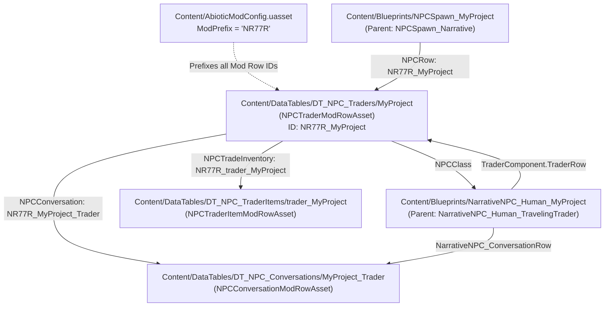

# Abiotic Factor Modding Context & Reference (`MyProjecty8BQn`)

This project is an **Abiotic Factor** mod generated from the official **"Traveling Trader"** mod template.
Both **Antigravity** (via `AGENTS.md`) and **Claude Code** (via `CLAUDE.md`) use this file as the shared source of truth for project structure, engine conventions, and binary `.uasset` internals.

---

## 1. Engine & Mod Architecture

- **Game**: Abiotic Factor (by Deep Field Games)
- **Engine Version**: Unreal Engine `5.4.4-1050002+++DF+ABF` (Custom UE 5.4.4 build)
- **Mod Type**: Content-only Unreal Engine Plugin (`"Category": "UGC"`, `"CanContainContent": true`, `"NoCode": true`, `"ExplicitlyLoaded": true`)
- **Plugin Mount Point**: `/MyProjecty8BQn/` (matches the `.uplugin` and folder name)
- **Packaging**: Uses Mod.io UGC (`Content/UUGC_Metadata.uasset`, native class `/Script/ModioUGC.UGC_Metadata`) with `EPrimaryAssetCookRule::AlwaysCook`.

### Important Note on `.uasset` Files
Unreal Engine `.uasset` files are binary serialized packages.
- **Do not** edit `.uasset` files as plain text.
- You **can** inspect strings, property names, class hierarchies, and row references inside `.uasset` files from PowerShell or Python (e.g., extracting ASCII/UTF-16 strings or parsing the UE5 package name table) to debug references without opening the Unreal Editor.

---

## 2. Directory & File Structure

This repository (`Loaded-Grayson`) is the single source of truth for development, tooling, documentation, and mod source files:

```text
Loaded-Grayson/                           # Git Repository Root
├── .gitignore                            # UE5 & Python gitignore rules
├── LICENSE                               # Mod license
├── README.md                             # Project overview & mod description
├── AGENTS.md                             # Antigravity project reference (this file)
├── CLAUDE.md                             # Claude Code entry point
├── Backups/
│   └── trader_MyProject.uasset.bak       # Pristine backup of vanilla Grayson uasset
├── Tools/
│   ├── ammo_exchange.py                  # Ratio calculator, CLI & automated applier
│   ├── patch_uasset_trades.py            # Low-level binary uasset patcher
│   └── verify_patch.py                   # Package integrity & trade table validator
│
└── MyProjecty8BQn/                       # Mod Plugin Mount (/MyProjecty8BQn/) - Uploaded to Mod.io
    ├── MyProjecty8BQn.abfmod             # Mod.io marker file with ModId
    ├── MyProjecty8BQn.uplugin            # UE5 plugin descriptor ("Loaded Grayson")
    ├── TemplateDefs.ini                  # Template metadata
    ├── Config/
    │   └── Tags/                         # Gameplay tag configurations
    ├── Media/
    │   ├── MyProjecty8BQn.png            # Mod icon (37 KB)
    │   └── MyProjecty8BQn_Preview.png    # Mod preview image (162 KB)
    └── Content/
        ├── AbioticModConfig.uasset       # ModPrefix ("NR77R")
        ├── UUGC_Metadata.uasset          # Mod.io UGC cook rules
        └── DataTables/
            └── DT_NPC_TraderItems/
                └── trader_MyProject.uasset # Patched Grayson trade table override
```
*(Note: The original `TP_TravelingTrader` template also included `Blueprints/NarrativeNPC_Human_MyProject.uasset`, `Blueprints/NPCSpawn_MyProject.uasset`, `DataTables/DT_NPC_Traders/MyProject.uasset`, and `DataTables/DT_NPC_Conversations/MyProject_Trader.uasset`, which were removed since this mod overrides the existing base-game Grayson rather than spawning a duplicate NPC.)*

---

## 3. Core Abiotic Factor Modding Concepts

### A. Mod Prefix (`AbioticModConfig.uasset`)
- **Native Class**: `/Script/AbioticFactor.AbioticModConfiguration`
- **Property**: `ModPrefix` (`NameProperty`) = **`NR77R`**
- **How It Works**: Abiotic Factor uses `ModPrefix` to namespace custom DataTable rows so multiple mods don't collide. When one asset references a custom mod row handle, the row name is formatted as **`<ModPrefix>_<AssetName>`**:
  - `DT_NPC_Traders/MyProject` $\rightarrow$ Row Handle: **`NR77R_MyProject`**
  - `DT_NPC_TraderItems/trader_MyProject` $\rightarrow$ Row Handle: **`NR77R_trader_MyProject`**
  - `DT_NPC_Conversations/MyProject_Trader` $\rightarrow$ Row Handle: **`NR77R_MyProject_Trader`**

### B. DataTable "Mod Row Assets" (`Content/DataTables/`)
Instead of overwriting base-game DataTables (which breaks mod compatibility), Abiotic Factor uses individual **Mod Row Assets** (`UAbioticModRowAsset` subclasses) placed in subdirectories named after the target DataTable:

| Subfolder | Base Game DataTable | Asset File | Native Class (`/Script/AbioticFactor.*`) | Row Handle ID |
| :--- | :--- | :--- | :--- | :--- |
| `DT_NPC_Traders/` | `/Game/Blueprints/DataTables/NarrativeNPCs/DT_NPC_Traders` | `MyProject.uasset` | `NPCTraderModRowAsset` | `NR77R_MyProject` |
| `DT_NPC_TraderItems/` | `/Game/Blueprints/DataTables/NarrativeNPCs/DT_NPC_TraderItems` | `trader_MyProject.uasset` | `NPCTraderItemModRowAsset` | `NR77R_trader_MyProject` |
| `DT_NPC_Conversations/` | `/Game/Blueprints/DataTables/NarrativeNPCs/DT_NPC_Conversations` | `MyProject_Trader.uasset` | `NPCConversationModRowAsset` | `NR77R_MyProject_Trader` |

#### Adding a New Row vs. Overriding a Base-Game Row (`bOverrideExistingRow`)
Every `UAbioticModRowAsset` is registered at runtime by `UABFRowRegistrySubsystem` and supports two modes:
1. **New Prefixed Row (Default, `bOverrideExistingRow = false`)**:
   - Registers a brand-new row prefixed with `<ModPrefix>_<RowName>` (e.g., `NR77R_trader_MyProject`).
   - In the Editor, you can populate it using the **"Copy From Row"** button to clone any base-game row's values.
2. **Override Base-Game Row (`bOverrideExistingRow = true`)**:
   - In the Editor Details panel of any Mod Row Asset, ticking **"Override Existing Row"** (`bOverrideExistingRow`) allows targeting an existing base-game row name directly (for example, `trader_grayson` in `DT_NPC_TraderItems`) without the `ModPrefix`.
   - This modifies the existing base-game NPC/item/trade in-place without needing a custom NPC Blueprint or spawner.

### C. Local SDK, Logs & Binary Inspection Paths
- **Mod Editor Binary**: `C:\Program Files\Epic Games\AbioticFactorModEditkx2ug\AbioticFactor\Binaries\Win64\AbioticFactorEditorCooked-Win64-Test.exe`
- **Cooked Base-Game Paks**: `C:\Program Files\Epic Games\AbioticFactorModEditkx2ug\AbioticFactor\Content\Paks\AbioticFactor-WindowsCookedEditor.{pak,utoc,ucas,o.utoc,o.ucas}`
- **Development Asset Registry (36 MB)**: `C:\Program Files\Epic Games\AbioticFactorModEditkx2ug\AbioticFactor\Releases\UGCRelease\Windows\Metadata\DevelopmentAssetRegistry.bin`
- **Mod Templates Directory**: `C:\Program Files\Epic Games\AbioticFactorModEditkx2ug\ModTemplates\` (contains 35 official templates including `TP_TravelingTrader`)
- **Live Editor / PIE Log**: `C:\Users\vczle\AppData\Local\AbioticFactor\Saved\Logs\AbioticFactor.log`
- **Performance Tip for LLM Agents**:
  - Do **not** run `re.finditer` over the entire 1.7 GB `.pak` or 6.5 GB `.ucas` file (it takes >10s).
  - Instead, search `DevelopmentAssetRegistry.bin` (36 MB) or `AbioticFactor-WindowsCookedEditor.o.ucas` (663 MB editor-only Blueprint/class metadata) using Python `bytes.find(b'...')` (<0.2s), and only run regex extraction on small 10–50 KB slices around matched offsets.

---

## 4. Detailed Breakdown of Template Assets

### 1. Trader Definition (`Content/DataTables/DT_NPC_Traders/MyProject.uasset`)
- **Native Class**: `/Script/AbioticFactor.NPCTraderModRowAsset` (wraps `NPCTrader` struct)
- **Key Properties**:
  - `NPCClass`: `/MyProjecty8BQn/Blueprints/NarrativeNPC_Human_MyProject.NarrativeNPC_Human_MyProject_C`
  - `NPCConversation` (`NPCConversationRowHandle`): `NR77R_MyProject_Trader`
  - `NPCTradeInventory` (`NPCTraderItemRowHandle`): `NR77R_trader_MyProject`
  - `NPCImage`: `/Game/Textures/GUI/Trading/T_UI_Trader_Grayson`
  - `RequiredWorldFlags` (Array of `WorldFlagRowHandle`): `Office_NewGameStarted`
  - `DaysOfTheWeek` (Array), `ChanceToSpawn` (`FloatProperty`)

### 2. Trader Inventory (`Content/DataTables/DT_NPC_TraderItems/trader_MyProject.uasset`)
- **Native Class**: `/Script/AbioticFactor.NPCTraderItemModRowAsset` (wraps `TraderItems` / `InstancedStruct` of `TraderItemWF`)
- **Origin**: The template's `trader_MyProject.uasset` is a direct copy of base-game Grayson's trade row (**`trader_grayson`** in `/Game/Blueprints/DataTables/NarrativeNPCs/DT_NPC_TraderItems`).
- **Key Properties**:
  - `BuyableItems` (Array of `TraderItemWF`):
    - `Output` (`AbioticItemCount` struct: `Item` [`GlobalItemRowHandle`], `Count` [`IntProperty`]) — item and quantity sold to the player.
    - `AvailableStock` (`IntProperty`) — stock limit per visit (`-1` = unlimited).
    - `WorldFlagToMakeAvailable` (`WorldFlagRowHandle`) — progression gate required before this trade appears.
  - `TradeableItems` (Parallel array of `AbioticItemCount` struct: `Item` [`GlobalItemRowHandle`], `Count` [`IntProperty`]) — item and quantity required from the player in exchange for the corresponding `BuyableItems[i]` entry.
- **Current Trades in `trader_MyProject.uasset` (`RowName = trader_grayson`, `bOverrideExistingRow = true`)**:

| Index | Output Item (`RowName`) | Output `Count` *(Vanilla)* | Cost Item (`TradeableItems`) | Cost `Count` | `AvailableStock` *(Vanilla)* | Total Max Ammo | `WorldFlagToMakeAvailable` |
| :---: | :--- | :---: | :--- | :---: | :---: | :---: | :--- |
| `0` | `armor_helmet_hardhat` | `1` | `salt` | `1` | `-1` | — | `Manufacturing_Arrived` |
| `1` | `armor_chest_highvisvest` | `1` | `food_tomato_super` | `1` | `-1` | — | `Manufacturing_Arrived` |
| `2` | `constructionsign` | `1` | `cpu` | `1` | `1` | — | `Manufacturing_Arrived` |
| `3` | `ammo_9mm` | **`20`** *(6)* | `oil_robot` | `1` | **`6`** *(3)* | **`120`** *(18)* | `Manufacturing_Arrived` |
| `4` | `ammo_12g` | **`2`** *(2)* | `woodplank` | `1` | **`15`** *(4)* | **`30`** *(8)* | `Labs_Containment_Entered` |
| `5` | `ammo_Magnum` | **`6`** *(3)* | `chains` | `1` | **`4`** *(3)* | **`24`** *(9)* | `Manufacturing_Arrived` |
| `6` | `ammo_308` *(FName `ammo` #309)* | **`15`** *(3)* | `growth` | `1` | **`2`** *(3)* | **`30`** *(9)* | `Dams_ReachedCentral` |
| `7` | `ammo_556` *(FName `ammo` #557)* | **`40`** *(10)* | `magalloy` | `1` | **`8`** *(3)* | **`320`** *(30)* | `Dams_ReachedCentral` |
| `8` | `gunrepairkit_t2` | `1` | `cpu_gold` | `1` | `1` | — | `Dams_ReachedCentral` |
| `9` | `ammo_Magnum` *(9mm $\rightarrow$ .357)* | **`6`** | `ammo_9mm` | **`30`** | **`99`** | **`594`** | `Manufacturing_Arrived` |
| `10` | `ammo_12g` *(.357 $\rightarrow$ 12g)* | **`10`** | `ammo_Magnum` | **`16`** | **`99`** | **`990`** | `Labs_Containment_Entered` |
| `11` | `ammo_308` *(12g $\rightarrow$ .308)* | **`5`** | `ammo_12g` | **`10`** | **`99`** | **`495`** | `Dams_ReachedCentral` |
| `12` | `ammo_556` *(.308 $\rightarrow$ 5.56)* | **`40`** | `ammo_308` | **`4`** | **`99`** | **`3960`** | `Dams_ReachedCentral` |
| `13` | `ammo_9mm` *(5.56 $\rightarrow$ 9mm)* | **`12`** | `ammo_556` | **`25`** | **`99`** | **`1188`** | `Dams_ReachedCentral` |

- **UI Layout & Screen Capacity (`W_TraderScreen.uasset`)**:
  - `ShopGridPanel` uses `Max Column = 1` (Columns 0 and 1 $\rightarrow$ 2 columns) and `Max Row = 6` (Rows 0 to 6 $\rightarrow$ 7 rows), giving an exact capacity of **14 slots** ($7 \times 2$).
  - Entries are indexed sequentially: `Row = Index % 7`, `Col = Index / 7`.
  - Column 0 (Rows 0–6) displays items `[0]` to `[6]`.
  - Column 1 (Rows 0–6) displays items `[7]` to `[13]`. Exactly 14 items completely fills the 2-column layout with zero UI overflow!

- **Magazine-Sized Material Trades & Circular Exchange (`Tools/ammo_exchange.py` & `Tools/patch_uasset_trades.py`)**:
  - **Thematic Magazine Quantities**: Base material trades yield 1 full magazine per unit (15 9mm, 6 .357, 5 12g shells, 5 .308, 50 5.56).
  - **Utility Stock**: Exchange rows have `AvailableStock = 99`, providing unrestricted conversion utility.
  - **Zero Arbitrage**: Cycle return is **40.63%** (every circular round trip loses ~59.4% of value).
  - **Progression-Aligned**: Unlocks naturally across game chapters (9mm $\rightarrow$ .357 at Manufacturing; .357 $\rightarrow$ 12g at Labs; .308, 5.56, and loop back to 9mm at Dams).
  - **Automated Patching**:
    - `python Tools/ammo_exchange.py` — Preview exchange ratios, efficiencies, and arbitrage verification.
    - `python Tools/ammo_exchange.py --apply` — Automatically patch all 5 exchange trades into `trader_MyProject.uasset` (requires closing Unreal Editor so file locks are released).
    - `python Tools/ammo_exchange.py --verify` — Parse and print all 14 active trades directly from the `.uasset`.
    - `python Tools/ammo_exchange.py --restore` — Revert `trader_MyProject.uasset` back to the vanilla state from `Backups/trader_MyProject.uasset.bak`.

### 3. Trader Dialogue (`Content/DataTables/DT_NPC_Conversations/MyProject_Trader.uasset`)
- **Native Class**: `/Script/AbioticFactor.NPCConversationModRowAsset` (wraps `NPCConversation` struct)
- **Key Properties**:
  - `NPCName` (`TextProperty`): Display name of the NPC (`"MyProject"` by default)
  - Dialogue Line Arrays (each element is an `NPCConversationLine` struct):
    - `BeckoningLines`
    - `InitalContactMessages` *(note base-game spelling: `Inital` instead of `Initial`)*
    - `ReturnMessages`
    - `VendorInteraction_Positive`
    - `VendorInteraction_Negative`
  - **`NPCConversationLine` Fields**:
    - `DialogToSpeak` (SoftObjectProperty to SoundWave, e.g., `/Game/Audio/NarrativeNPCs/ForkliftOperator/Trader/Trader_Greyson_*_Dialogue`)
    - `DialogMontage`, `MontageDelay` (`FloatProperty`)
    - `CompendiumEntriesToUnlock` (Array of `CompendiumEntryRowHandle`)
    - `JournalEntriesToAdd` (Array of `JournalEntryRowHandle`)
    - `RecipesToUnlock` (Array of `RecipeRowHandle`)
    - `WorldFlagsToTrigger` (Array of `WorldFlagRowHandle`)

### 4. Trader Character Blueprint (`Content/Blueprints/NarrativeNPC_Human_MyProject.uasset`)
- **Inheritance Chain**:
  - `/Script/AbioticFactor.AbioticCharacter` (Native C++)
  - $\rightarrow$ `/Game/Blueprints/Characters/NarrativeNPCs/NarrativeNPC_ParentBP`
  - $\rightarrow$ `/Game/Blueprints/Characters/NarrativeNPCs/NarrativeNPC_Human_ParentBP`
  - $\rightarrow$ `/Game/Blueprints/Characters/NarrativeNPCs/NarrativeNPC_Human_TravelingTrader`
  - $\rightarrow$ `NarrativeNPC_Human_MyProject_C`
- **Key Components & Properties**:
  - `TraderComponent` (`/Game/Blueprints/Characters/Components/TraderComponent`): `TraderRow` = `NR77R_MyProject`
  - `NarrativeNPC_ConversationRow` (`NPCConversationRowHandle`): `NR77R_MyProject_Trader`
  - `HumanCustomizationComponent` (`/Game/Blueprints/Characters/HumanCustomizationComponent`):
    - Configured with RowHandles: `Head_M01a`, `Hair_Bald`, `HairColor_Bronze`, `Beard_Dutch_A`, `UpperBody_Engineer_Rolled`, `ShirtColor_EngiOrange`, `Belt_Default`, `Shoes_Beige`, `Tie_Bolts`, `Watch_Black`, `Glasses_None`, `id_mf`
  - Attached Mesh Components:
    - `Hat`: `SK_Armor_Hardhat_Helmet` (`M_Armor_Hardhat_Brown`)
    - `ArmorSuit_Chest`: `SK_Armor_SafteyVest_Chest` (`M_SafetyVest_Bandaged`)
    - `Backpack`: `SM_SecurityBackpack` (`M_SecurityBackpack`)
    - `Beard`: `SK_Beard_Dutch_A`
    - `Chest`: `SK_Torso_Engineer_Rolled_M`

### 5. Trader Spawner Blueprint (`Content/Blueprints/NPCSpawn_MyProject.uasset`)
- **Inheritance Chain**:
  - `/Script/Engine.Actor` (Native C++)
  - $\rightarrow$ `/Game/Blueprints/Environment/Spawns/NPCSpawn_Narrative`
  - $\rightarrow$ `NPCSpawn_MyProject_C`
- **Key Properties**:
  - `NPCRow` (`NPCTraderRowHandle`): `NR77R_MyProject`
  - `WorldFlag` (`WorldFlagRowHandle`): `Office_NewGameStarted`

---

## 5. How Assets Link Together



---

## 6. Play-In-Editor (PIE) Testing & Developer Cheat Menu

When opening the Mod Editor, it defaults to `/Game/Maps/Empty` (a single floating platform with a `PlayerStart`). Testing traders, world flags, and items on `/Game/Maps/Empty` has several important nuances:

### A. Why Directly Placed Traders Have `0` Stock (`Out of Stock`)
- Dragging a trader character Blueprint (such as `/Game/Blueprints/Characters/NarrativeNPCs/NarrativeNPC_Human_GraysonTrader`) directly into the level lets you talk to them and view their `BuyableItems` / `TradeableItems` ratios, **but every item will have `0` stock**.
- **Reason**: Trader inventory stock (`TradeStock` in `NarrativeNPCSpawns_Struct`) is initialized and managed by **`NarrativeNPCDirectorComponent`** (attached to **`Abiotic_AIDirector`**), not by the character Blueprint itself.
- **Required Level Setup for Spawning Traders with Stock**:
  1. **`Abiotic_AIDirector`** (`/Game/Blueprints/Environment/Systems/Abiotic_AIDirector`)
  2. **`DayNightManager`** (`/Game/Blueprints/Environment/Systems/DayNightManager`) — required by `NarrativeNPCDirectorComponent` on `BeginPlay` to bind `OnHourChanged`; without it, `NPCSpawn_Narrative` remains stuck on `"PENDING DIRECTOR"`.
  3. **`NPCSpawn_Narrative`** (`/Game/Blueprints/Environment/Spawns/NPCSpawn_Narrative`) — set `NPCRow` to the trader's row name in `DT_NPC_Traders` (e.g., `Grayson`) and leave `WorldFlag` as `None`. *(Note: `"PENDING DIRECTOR"` is the default 3D `DebugText` in the Editor viewport before hitting Play, and traders only roll `ChanceToSpawn` on hourly/daily ticks unless force-spawned via the `\` Cheat Menu.)*

### B. World Flag Timing on `/Game/Maps/Empty`
- If a `Trigger_WorldFlag` actor (`/Game/Blueprints/Environment/Triggers/Trigger_WorldFlag`) overlaps `PlayerStart` at the exact instant PIE starts, it fires before `UWorldFlagSubsystem` finishes loading world flags and fails with:
  `AbioticWorldFlagSubsystem: Error: SetWorldFlag: Trigger_WorldFlag_C:<FlagName> ran before world flags were loaded, this is bad and should be fixed!`
- Always place `Trigger_WorldFlag` a few steps away from `PlayerStart` so the player walks into it after spawning, **or** trigger flags using the `\` Developer Game Command Menu.

### C. Built-in Developer Game Command Menu (`\` Backslash Key)
While playing in PIE, pressing **`\` (Backslash)** opens Abiotic Factor's built-in **Game Command Menu** (`/Game/Blueprints/Widgets/GameCommand/W_GameCommandMenu`, hosted inside `/Game/Blueprints/Developer/W_CheatMenu`). It provides a searchable command list with parameter dropdowns:

| Game Command | Purpose |
| :--- | :--- |
| **`TriggerEveryWorldFlag`** / **`TriggerWorldFlag`** | Unlocks all world flags (or a specific flag like `Manufacturing_Arrived`, `Labs_Containment_Entered`, `Dams_ReachedCentral`) cleanly after subsystems initialize. |
| **`SpawnTrader`** | Forces `NarrativeNPCDirectorComponent` (`ForceSpawnClosestByRowName`) to immediately spawn the selected trader (e.g., `Grayson`) at the closest `NPCSpawn_Narrative` with full `TradeStock`. |
| **`SpawnItem`** / **`SpawnItemOnGround`** | Spawns any item from `DT_Items` (e.g., `oil_robot`, `chains`, `woodplank`, `growth`, `magalloy`, `salt`, `cpu_gold`) directly into the player's inventory or on the ground. |
| **`GoToTraderTime`** | Advances `DayNightManager` to a valid day/hour for the selected trader. |
| **`LevelFX_SpawnGlobalActors`** | Spawns global system actors (`Abiotic_AIDirector`, `DayNightManager`, `FacilityQuaker`, `AbioticSkylight`) at runtime. |

---

## 7. Package Binary Serialization Gotchas (UE5 `LinkerLoad` & `ScriptSerializationEndOffset`)

When programmatically modifying or appending serialized properties to `.uasset` binary packages (such as cloning `TraderItemWF` elements in `trader_MyProject.uasset`), updating `SerialSize` and array counts alone is insufficient.

### A. The LinkerLoad Deserialization Assertion
During cloud cooking or strict headless verification (`AbioticFactorEditorCookedCooker-Cmd.exe`), the engine enforces an exact byte check in `LinkerLoad.cpp:6331`:
```text
LogWindows: Error: Assertion failed: Export.ScriptSerializationEndOffset == (Tell() - Export.SerialOffset) 
[File:Engine\Source\Runtime\CoreUObject\Private\UObject\LinkerLoad.cpp] [Line: 6331] 
Serialized script property end offset does not match offset during deserialization
```

### B. `FObjectExport` Layout in UE 5.4.4 (112 Bytes per Export)
Every export entry in the package Export Table contains:
* `+28` (`int64`): `SerialSize` — Total byte size of the serialized export payload.
* `+36` (`int64`): `SerialOffset` — Absolute stream offset where the export begins.
* `+96` (`int64`): `ScriptSerializationStartOffset` — Relative offset where script properties start (usually `0`).
* `+104` (`int64`): **`ScriptSerializationEndOffset`** — Relative stream position where script property serialization terminates (before the final 4-byte `PACKAGE_FILE_TAG` `0x9E2A83C1`).

### C. Offsets in `trader_MyProject.uasset`
In `trader_MyProject.uasset`, the export table begins at offset `1840` (`ExportOffset`), containing 2 exports:
* **Export 1**: Offset `1840` to `1952`
* **Export 2** (`trader_MyProject` data row): Offset `1952` to `2064`
  * `SerialSize` is located at byte offset **`1980`** (`1952 + 28`).
  * `ScriptSerializationEndOffset` is located at byte offset **`2056`** (`1952 + 104`).

> [!CRITICAL]
> Whenever `total_added_bytes` is appended to Export 2, byte offset **`2056`** (`ScriptSerializationEndOffset`) must be updated to **`serial_size - 4`** (or `4196 + total_added_bytes`). Failing to update offset `2056` causes headless cookers and cloud builders to abort with exit code 3.

---

## 8. Packaging, Local Testing & Mod.io Publishing Pipeline

### A. Why Local `Package UGC` & `RunUAT.bat` Fail
The standalone Abiotic Factor Mod Editor (`AbioticFactorEditorCooked-Win64-Test.exe`) is distributed without the Unreal Automation Tool (`Engine/Build/BatchFiles/RunUAT.bat` or `AutomationTool.dll`).
* Clicking generic Unreal Engine toolbar options such as **"Package UGC"**, **"Platforms -> Package Project"**, or **"Project Launcher"** will fail with:
  `A required file could not be found: .../Engine/Build/BatchFiles/RunUAT.bat` or `SDK Not Setup`.
* This is intentional: Deep Field Games designed mod packaging to run through the official **Mod.io Cloud Cooking** pipeline rather than local UAT compilation.

### B. The Official In-Editor Publishing Tool ("Upload Mod")
To package and publish your mod:
1. In the Mod Editor toolbar, click the **Mod.io / "Upload Mod"** button.
2. Select **"Add New Mod Listing"** (or choose your existing listing).
3. Under **Mod Root Directory (`ModRootDir`)**, select the clean plugin directory inside this repository:
   `C:\Users\vczle\Documents\Abiotic Factor Mods\Loaded-Grayson\MyProjecty8BQn`
   *(Important: Do NOT select the repository root `Loaded-Grayson/`! The Mod.io upload tool zips the entire selected directory into `modfile_*.zip`. Selecting `MyProjecty8BQn/` ensures only the necessary `.uplugin`, `Content/`, and `Media/` files are uploaded, keeping the archive small (~15 KB) and free of development files or git history.)*
4. Configure upload fields:
   * **Platform**: Check **`Windows`**.
   * **Version String**: e.g., `1.0.0`.
   * **Changelog**: Describe changes (e.g., `Initial release with ammo exchange trades`).
   * Check **"Set as Active Release"** and **"I agree to the terms and privacy policy"**.
5. Click **"Upload Mod File"**. Mod.io's cloud build servers will automatically cook, package, and generate the final distribution `.zip`/`.pak` archives.

### C. Testing in the Steam Game Copy (Local / Private Testing)
You can verify your mod in the real Steam game before releasing it publicly:
* **Option 1: Mod.io Hidden Release (Recommended)**
  * On your mod's page at [mod.io/g/abiotic-factor](https://mod.io/g/abiotic-factor), set visibility to **Hidden** (Private).
  * Launch your Steam copy of **Abiotic Factor** $\rightarrow$ Click **Mods** on the main menu.
  * Your hidden mod is visible only to your logged-in account. Click **Subscribe** to download and mount it.
  * Test in a singleplayer or co-op save. Once verified, change the mod.io visibility to **Public**.
* **Option 2: Offline Direct Pak Drop (`~mods` folder)**
  * Any cooked `.pak`, `.ucas`, and `.utoc` files can be placed directly into:
    `C:\Program Files (x86)\Steam\steamapps\common\AbioticFactor\AbioticFactor\Content\Paks\~mods\`
  * The game engine mounts `~mods` automatically on launch without any internet connection or mod.io subscription required.

---

## 9. Plugin Mount Points & Mod Prefix Collision Rules

### A. Strict Plugin Folder Naming & Engine Mount Points
In Unreal Engine, the directory containing `.uplugin` defines the plugin's virtual package mount point (`/<FolderName>/`):
- In this mod, the folder is **`MyProjecty8BQn`**, creating the mount point **`/MyProjecty8BQn/`**.
- All internal asset paths (e.g., `/MyProjecty8BQn/DataTables/DT_NPC_TraderItems/trader_MyProject`) are hardcoded to this mount point in the serialized binary data.
- **Do not rename the folder** `MyProjecty8BQn` (e.g., to `LoadedGrayson` or `src`). Renaming the directory without binary package re-serialization or Unreal asset redirectors will break all package imports and crash the game engine.
- To display a user-friendly name in mod menus and stores, customize `FriendlyName` in `MyProjecty8BQn.uplugin` (set to `"FriendlyName": "Loaded Grayson"`).

### B. Mod Prefix Collision (`UABFRowRegistrySubsystem`)
At runtime, Abiotic Factor's `UABFRowRegistrySubsystem::OnUGCPackagesChanged` discovers installed mods by scanning for `.abfmod` and `.uplugin` packages, reading each mod's `ModPrefix` from `Content/AbioticModConfig.uasset` (e.g., `NR77R`):
- **Collision Warning**: If two separate folders on disk contain the same `ModPrefix`, the engine logs:
  `Mod plugins '%s' and '%s' share the row prefix '%s' (copied mod?). Their row namespaces merge; per-row conflicts take last registered.`
- **Rule**: Never keep duplicate copies of the plugin folder (e.g., an unzipped backup and a working copy) inside the scanned mod directories. Maintain only one active plugin directory with a given `ModPrefix`.

---

## 10. Development Workflow, File Locks & Git Best Practices

### A. Windows File Locks & Asset Memory-Mapping
1. **Unreal Editor Asset Lock (`[Errno 13] Permission denied`)**:
   - The Unreal Editor memory-maps loaded `.uasset` files on disk while open.
   - Any attempt to run python binary patchers (e.g., `python Tools/ammo_exchange.py --apply`) while the editor is running will fail with a file lock error.
   - **Always close the Abiotic Factor Mod Editor** before running binary modification scripts.
2. **Current Working Directory Lock**:
   - If a shell or terminal process has a directory set as its Current Working Directory (CWD), Windows prevents deleting or moving that directory (`Cannot move item because the item at '...' is in use`).
   - Navigate away (`cd ..` or `Set-Location`) before attempting to move or delete directory trees.

### B. Multi-Account Git & GitHub CLI Device Authentication
When working on GitHub projects across multiple user accounts on Windows:
- Windows Git Credential Manager caches credentials per-host (`git:https://github.com`).
- To push using a specific GitHub account (`Jintoboy`):
  1. Use the GitHub CLI device code flow: `gh auth login --web -h github.com -p https`
  2. Visit [https://github.com/login/device](https://github.com/login/device) in your browser and authorize the one-time code while signed into the target account.
  3. Run `gh auth setup-git` to configure Git to use `gh` as the active credential helper.
  4. Ensure repository local config has matching commit authorship:
     ```powershell
     git config user.name "Jintoboy"
     git config user.email "jintoboy@gmail.com"
     ```

---

## 11. Mod.io Storefront Copy & Formatting Guidelines

### A. Formatting for Mod.io Descriptions
- The Mod.io web description editor does **not** render GitHub-flavored Markdown pipe tables (`| col | col |`). Tables will render as broken, unaligned plain text.
- Instead, format trade tables and feature lists using **clean unicode bullet points (`•`)**, clear uppercase section headers, and direct arrows (`Give X -> Receive Y`).

### B. Summary Character Limit
- Mod.io enforces a short summary character limit displayed on search cards and game client menus.
- Keep the summary punchy, weapon-aligned, and under 100 characters:
  > *"Magazine-sized ammo batches, increased stock, and balanced ammo conversion trades for Grayson."*

